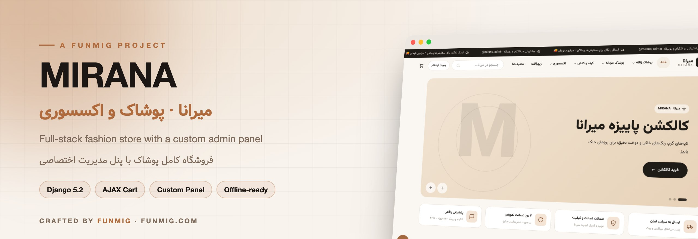
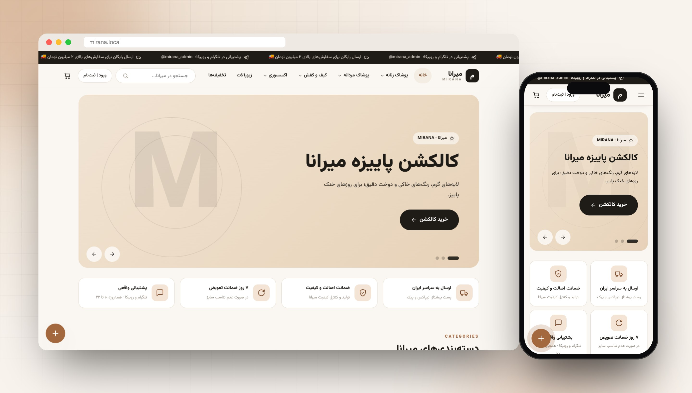
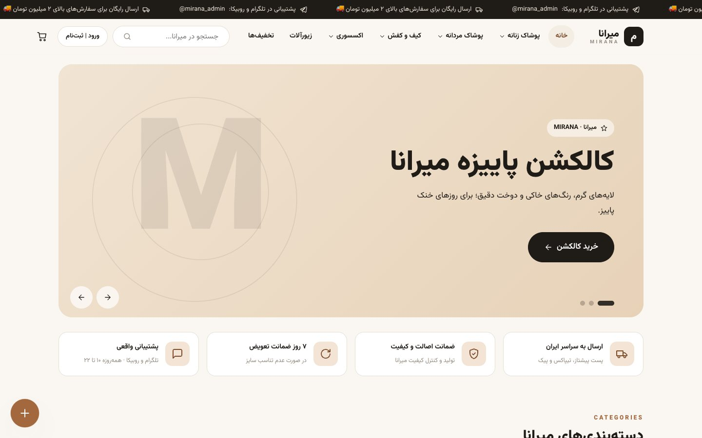
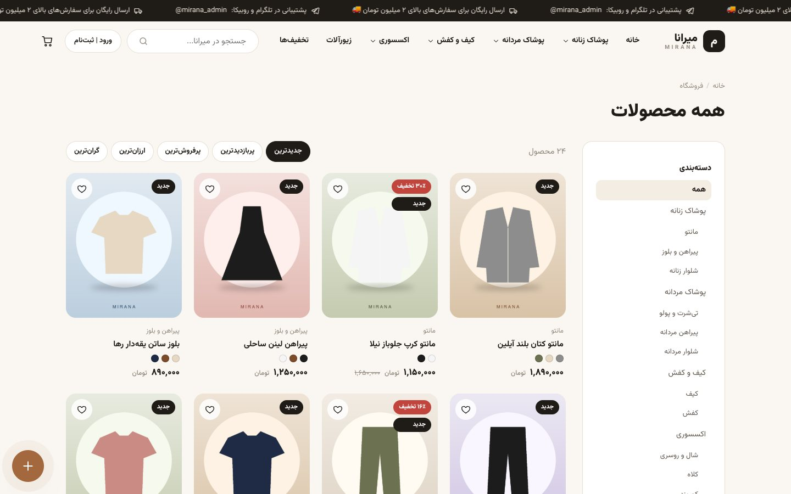
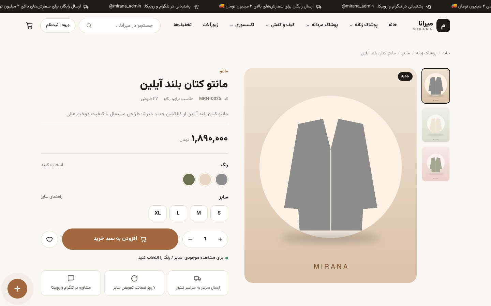
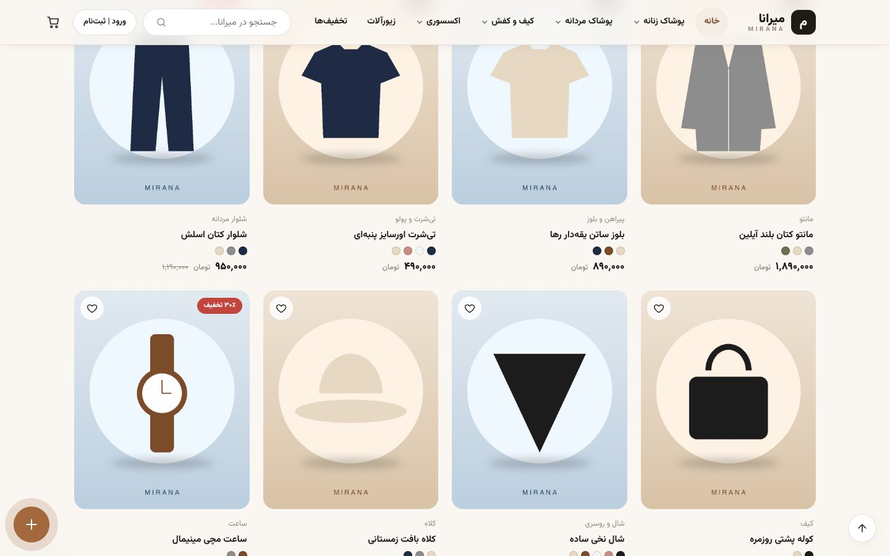
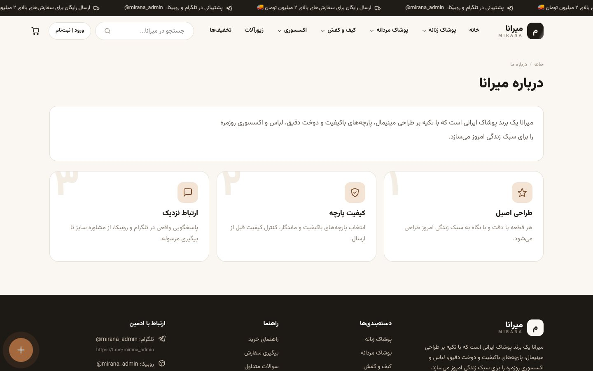
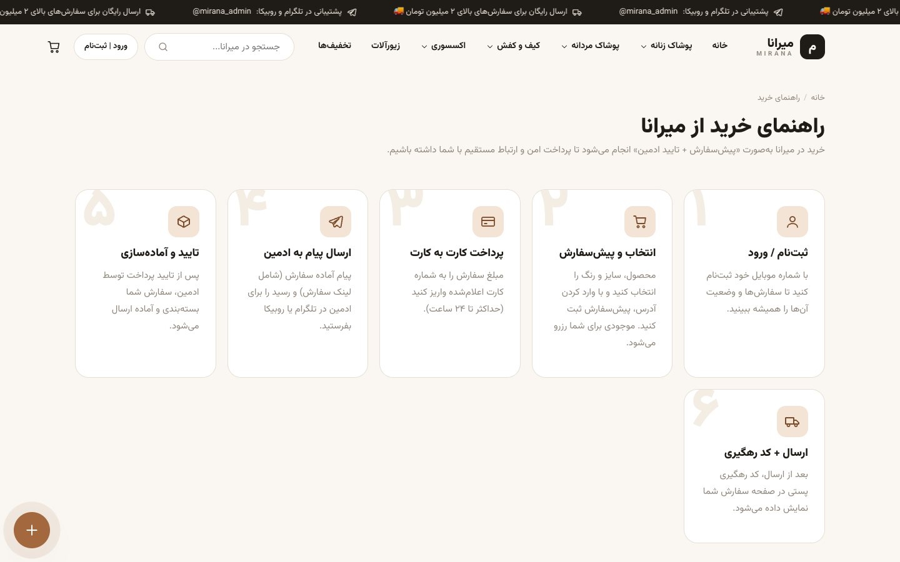
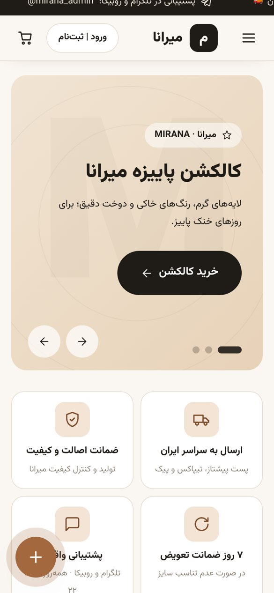

<div align="center">



<br>


<br><br>

**[🇬🇧 English](#-english)** &nbsp;·&nbsp; **[🇮🇷 فارسی](#-فارسی)**

<br>



</div>

<br>

## 🇬🇧 English

**MIRANA** is a complete online clothing and accessories store built with **Django** and a hand-written front end in plain HTML, CSS and JavaScript. Fonts, icons and scripts all ship inside the project, with no CDN or external API. The store works on restricted networks such as Iran's National Information Network, where foreign CDNs are often unreachable.

### ✨ Highlights

<table>
<tr>
<td width="50%" valign="top">

#### 🛍️ Storefront
- Nested categories: women, men, bags & shoes, accessories, jewelry
- Product gallery with zoom, separate **color × size × stock** variants, sale prices, size guide
- Search, filters (category, gender, size, price, in stock, on sale), sorting, pagination
- **AJAX cart** with a fly-to-cart animation, a free-shipping progress bar and coupon codes
- Wishlist, profile, saved addresses, mobile-number sign-up
- Jalali (Persian) dates and Persian digits throughout

</td>
<td width="50%" valign="top">

#### 🧑‍💼 Custom admin panel `/panel/`
- Dashboard: KPIs, 14-day sales chart, order status, best sellers, low-stock alerts
- One-click payment approval → preparing → shipped with **postal tracking code** → delivered
- Cancelling an order returns its stock to inventory automatically
- Printable invoices and shipping labels
- Bulk gallery upload and a **size × color variant generator**
- Coupons, home slider, users & admins, contact messages, store settings
- Dark mode, collapsible sidebar, fully responsive

</td>
</tr>
</table>

#### 🔁 Pre-order flow
```
Checkout → card number + ready-made message (with order link) → send via Telegram / Rubika
        → admin approves payment → preparing → shipped (tracking code) → delivered
```
Customers get an order page with a progress bar, status history, receipt upload and pre-order cancellation. Guests can track an order with its code and their phone number.

### 📸 Screenshots

| Home | Shop |
|:---:|:---:|
|  |  |
| **Product page** | **Product grid** |
|  |  |
| **About** | **How to buy** |
|  |  |

<p align="center"></p>

### 🚀 Quick start

```bash
python3 -m venv .venv
source .venv/bin/activate            # Windows: .venv\Scripts\activate
pip install -r requirements.txt
python manage.py migrate
python manage.py seed_demo           # demo catalog + admin account
python manage.py runserver
```

| URL | What |
|---|---|
| `http://127.0.0.1:8000` | Storefront |
| `http://127.0.0.1:8000/panel/` | Admin panel |
| `http://127.0.0.1:8000/django-admin/` | Django admin (fallback) |

> [!IMPORTANT]
> `seed_demo` creates the demo account `admin / admin1234`. Change the password right away, or pass `--admin-pass <strong-password>`. To skip demo data, run `python manage.py createsuperuser` instead.

Your first task in the panel is **Store settings**: enter the admin's Telegram and Rubika IDs, the card number and the shipping cost.

### ⚙️ Configuration

| Variable | Default | Description |
|---|---|---|
| `MIRANA_DEBUG` | `1` | Set to `0` in production |
| `MIRANA_SECRET_KEY` | dev key | **Required** in production |
| `MIRANA_ALLOWED_HOSTS` | `*` | Comma-separated domains |
| `MIRANA_CSRF_ORIGINS` | – | e.g. `https://example.com` |
| `MIRANA_SECURE_SSL_REDIRECT` | `0` | `1` to force HTTPS |

You can start from [`.env.example`](.env.example).

### 🌐 Deployment

<details>
<summary><b>Offline / restricted-network install</b></summary>

```bash
pip download -r requirements.txt -d wheels                       # on a machine with internet
pip install --no-index --find-links=wheels -r requirements.txt   # on the server
```
</details>

<details>
<summary><b>Gunicorn + Nginx + systemd</b></summary>

```bash
export MIRANA_DEBUG=0 MIRANA_SECRET_KEY="<long-random-string>"
python manage.py collectstatic --noinput
gunicorn mirana.wsgi -b 127.0.0.1:8000
```
Ready-made templates live in [`deploy/`](deploy): a systemd unit, an Nginx site and an activation script. Point `/static/` at `staticfiles/` and `/media/` at `media/`.
</details>

### 🧪 Tests

```bash
python manage.py test
```

### 📂 Structure

```
mirana/      settings & URLs
core/        site settings, slider, contact, static pages, Jalali utils, template tags, seed_demo
shop/        categories, products, gallery, variants, session cart, wishlist
orders/      orders, items, status history, coupons, payment & shipping
accounts/    sign-up, login, profile
dashboard/   custom admin panel
templates/   HTML templates   ·   static/   CSS / JS / fonts / images
```

<br>

---

<div dir="rtl">

## 🇮🇷 فارسی

**میرانا** یک فروشگاه اینترنتی کامل پوشاک و اکسسوری است. بک‌اند آن با **جنگو** و فرانت‌اند آن به‌صورت دست‌نویس با HTML، CSS و JS خالص ساخته شده است. پروژه **هیچ لینک یا CDN آنلاینی ندارد** و فونت، آیکون و اسکریپت‌ها همه داخل خود پروژه هستند. به همین دلیل سایت روی **شبکه ملی اینترنت** هم بدون مشکل کار می‌کند.

### ✨ امکانات

**🛍️ سمت مشتری**
- دسته‌بندی چندسطحی: پوشاک زنانه و مردانه، کیف و کفش، اکسسوری، زیورآلات
- گالری تصویر محصول با زوم، تنوع **رنگ × سایز × موجودی**، قیمت تخفیف‌خورده و راهنمای سایز
- جستجو، فیلتر (دسته، جنسیت، سایز، قیمت، موجود، تخفیف‌دار)، مرتب‌سازی و صفحه‌بندی
- **سبد خرید AJAX** با انیمیشن پرواز محصول به سبد، نوار ارسال رایگان و کد تخفیف
- ثبت‌نام با موبایل، پروفایل، آدرس پیش‌فرض و علاقه‌مندی‌ها
- تاریخ شمسی و اعداد فارسی، کاملاً ریسپانسیو، همراه با موشن و انیمیشن

**🧑‍💼 پنل مدیریت گرافیکی** (`/panel/`)
- داشبورد با آمار، نمودار فروش ۱۴ روز، پرفروش‌ها و هشدار کمبود موجودی
- تأیید پرداخت با یک کلیک، آماده‌سازی، ثبت ارسال با **کد رهگیری پستی** و تحویل
- با لغو سفارش، موجودی به‌طور خودکار به انبار برمی‌گردد. فاکتور و برچسب پستی قابل چاپ است
- آپلود چندتایی گالری و **ساخت سریع ترکیب سایز × رنگ**
- مدیریت کد تخفیف، اسلایدر، کاربران، پیام‌ها و تنظیمات فروشگاه، با حالت تیره

**🔁 روند پیش‌سفارش:** ثبت ← نمایش شماره کارت و پیام آماده ← ارسال در **تلگرام** یا **روبیکا** ← تأیید پرداخت ← آماده‌سازی ← ارسال با کد رهگیری

### 🚀 اجرا

```bash
python3 -m venv .venv
source .venv/bin/activate
pip install -r requirements.txt
python manage.py migrate
python manage.py seed_demo
python manage.py runserver
```

- سایت: `http://127.0.0.1:8000`
- پنل مدیریت: `http://127.0.0.1:8000/panel/`

> [!IMPORTANT]
> دستور `seed_demo` یک ادمین نمونه با نام کاربری و رمز `admin / admin1234` می‌سازد. حتماً رمز را از «پنل ← کاربران» تغییر دهید.

اولین کار در پنل: در بخش **تنظیمات فروشگاه** آیدی تلگرام و روبیکا، شماره کارت و هزینه ارسال را وارد کنید.

### 🌐 استقرار

برای سرور بدون اینترنت آزاد، بسته‌ها را روی سیستمی که اینترنت دارد با `pip download` بگیرید و روی سرور با `--no-index` نصب کنید. قالب‌های آماده systemd، Nginx و اسکریپت فعال‌سازی در پوشه [`deploy/`](deploy) قرار دارند. متغیرهای محیطی در [`.env.example`](.env.example) آمده‌اند.

### 🧪 تست

```bash
python manage.py test
```

</div>

<br>

---

<div align="center">

<sub>فونت وزیرمتن تحت مجوز SIL Open Font License منتشر شده است · The Vazirmatn font is released under the SIL Open Font License</sub>

<br><br>

**Crafted with ❤️ by [FUNMIG](https://funmig.com)**

<sub>طراحی و توسعه توسط تیم فان‌میگ</sub>

</div>
